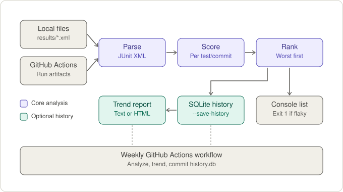

<div align="center">

# 🧁 flaky-test-detector 🔍✨

**Sniffs out flaky tests from your CI history and ranks the naughtiest ones** 🐛📊


</div>

> 🎲 A test is **flaky** when, on the **same commit**, it passes in one run and fails in another, with no code changes in between. Spooky! 👻

## 💖 Why this matters

Flaky tests cost teams time and trust:

- 🔁 Pipelines get re-run "just to see if it passes".
- 🙈 Real failures start being ignored ("probably that test again").
- 💸 CI time and cost per pipeline go up.

This project turns the problem into a measurable number: the **flakiness rate per test**. 📊

## 🌸 How it works

<div align="center">



</div>

1. 📥 **Collects** test results from multiple CI runs (JUnit XML or the GitHub Actions API).
2. 🧺 **Groups** results by test and by commit.
3. 🧮 **Scores** flakiness: in how many commits the same test had different outcomes.
4. 🏆 **Ranks** the most unstable tests, keeping those above a configurable threshold.
5. 📝 **Optionally writes** result files (JSON, CSV and Markdown) with `--output-dir` (see *Result files* below).

### 🍰 The scoring

> Simplified for illustration. The real implementation lives in `flaky_detector/scoring.py` (`FlakinessScorer` + `FlakinessRanker`): it ignores results without a commit SHA, never counts skipped tests, and treats both `failed` and `error` as failures.

```python
from collections import defaultdict

def flaky_score(runs):
    """runs: list of (test_name, commit_sha, passed)"""
    by_test = defaultdict(lambda: defaultdict(set))
    for name, sha, passed in runs:
        by_test[name][sha].add(passed)

    scores = {}
    for name, commits in by_test.items():
        # flaky = same commit, different results
        flaky = sum(1 for r in commits.values() if len(r) > 1)
        scores[name] = flaky / len(commits)

    return dict(sorted(scores.items(), key=lambda x: -x[1]))
```

**Example:** a test ran on 10 commits and, in 3 of them, both passed and failed on the same commit → score of `0.30` (30%) 🎀

## 🛍️ Installation

```bash
git clone https://github.com/<your-username>/flaky-test-detector.git
cd flaky-test-detector
uv sync          # creates .venv and installs dev tools (pytest)
```

The detector has **no runtime dependencies** (standard library only), so without `uv` you can
just run it with Python 3.10+. Install `pytest` only if you want to run the tests.

Requirements: Python 3.10+ 🐍

## 🎀 Usage

### 📂 Analyze local JUnit XML files

```bash
python -m flaky_detector analyze ./results/*.xml --threshold 0.1
```

No data yet? Generate synthetic runs (deterministic for a given `--seed`):

```bash
python scripts/generate_junit.py --commits 40 --runs 3 --out results
```

### 🐙 Analyze GitHub Actions runs

The token is read from the `GITHUB_TOKEN` environment variable or from a `.env` file:

```bash
echo "GITHUB_TOKEN=<your-token>" > .env   # or: export GITHUB_TOKEN=<your-token>
python -m flaky_detector analyze --repo owner/repo --last-runs 50
```

> 📦 **Prerequisite:** the analyzed repository must publish its JUnit XML as a workflow artifact
> (the detector reads every `.xml` inside the artifacts of the last runs). Use a distinct artifact
> name per attempt (e.g. `run_attempt`) so re-runs of the same commit keep their own results:
>
> ```yaml
> - run: pytest --junitxml=results/junit.xml
> - uses: actions/upload-artifact@v4
>   if: always()   # upload even when tests fail
>   with:
>     name: junit-${{ github.run_attempt }}
>     path: results/junit.xml
> ```
>
> Without artifacts, `analyze` finds 0 results.

### 🌈 Example output

Real output on the sample data in `results/`:

```
Parsed 19644 results from 186 file(s).
12 flaky test(s):
  0.70  tests.checkout.test_cart::test_9  (42/60 commits)
  0.70  tests.notifications.test_email::test_3  (42/60 commits)
  0.62  tests.api.test_users::test_2  (37/60 commits)
  0.48  tests.checkout.test_cart::test_10  (29/60 commits)
  ...
```

Each line is `score  test name  (flaky commits / commits with data)`.

**Exit codes:** `0` no flaky tests · `1` flaky tests found (so CI can fail on it) · `2` error
(bad input, missing token, GitHub API failure).

### 📝 Result files (JSON, CSV, Markdown)

Write the analysis to files with `--output-dir`:

```bash
python -m flaky_detector analyze ./results/*.xml --output-dir reports
python -m flaky_detector analyze ./results/*.xml --output-dir reports --formats json,md
```

| File | Content |
|---|---|
| `flaky-report.json` | Settings, summary (`flaky_count`, `flaky_rate`, …) and every analyzed test with `score`, `commits`, `flaky_commits`, `is_flaky` and `commits_where_flaky` |
| `flaky-report.csv` | One row per analyzed test: `test,score,flaky_commits,commits,is_flaky,commits_where_flaky` |
| `flaky-report.md` | Human-readable summary and a ranked table of the flaky tests |

The files are written even when no flaky test is found. To follow the trend over time, keep
the JSON files of each run (e.g. as CI artifacts) and compare them.

## 🎛️ Options

### `analyze`

| Option | Description | Default |
|---|---|---|
| `files` | Local JUnit XML files (positional, optional if `--repo` is set) | – |
| `--repo owner/name` | Also fetch JUnit artifacts from GitHub Actions | off |
| `--last-runs` | Number of GitHub Actions runs to analyze | `30` |
| `--threshold` | Minimum score (0–1) to consider a test flaky | `0.1` |
| `--min-commits` | Ignore tests seen on fewer commits than this | `5` |
| `--output-dir DIR` | Write result files (JSON, CSV, Markdown) to this directory | off |
| `--formats` | Comma-separated formats to write: `json`, `csv`, `md` | all |

## 🤖 Using it in GitHub Actions

A ready-to-use workflow lives in [`.github/workflows/flaky-report.yml`](.github/workflows/flaky-report.yml).
Every Monday (or on demand) it:

1. 🔍 runs `analyze --output-dir reports`;
2. 📋 shows the Markdown report in the run's **Job Summary**;
3. 📦 uploads `reports/` (JSON, CSV, Markdown) as the `flaky-report` artifact.

Needs `contents: read` and `actions: read` permissions (already set in the file). Note that
`analyze` exits with `1` when it finds flaky tests; the workflow tolerates that so the report is
still produced.

The workflow analyzes the repository it runs in, so that repository needs a test workflow that
uploads JUnit artifacts (see the *Prerequisite* above); otherwise the snapshot is empty.

## 🗂️ Project structure

```
flaky-test-detector/
├── .github/workflows/
│   └── flaky-report.yml   # weekly analysis + result files
├── docs/
│   └── how-it-works.svg   # diagram used in this README
├── flaky_detector/
│   ├── __init__.py
│   ├── __main__.py        # CLI
│   ├── parsers.py         # JUnit XML parser
│   ├── github.py          # fetches JUnit artifacts from GitHub Actions
│   ├── scoring.py         # flakiness scoring and ranking
│   └── report.py          # result files (JSON / CSV / Markdown)
├── scripts/
│   └── generate_junit.py  # generates sample JUnit XML files
├── results/               # sample JUnit XML files
├── tests/
├── pyproject.toml         # project metadata and dev dependencies (uv)
├── requirements.txt
└── README.md
```

## 🚧 Limitations

- 🔁 Flakiness can only be detected when there is **more than one run on the same commit** (re-runs). Without re-runs, a test can't be classified.
- 🌩️ Failures caused by infrastructure (runner timeouts, network drops) may show up as flakiness and should be reviewed manually.

## 🗺️ Roadmap

Things planned for the future:

- [x] ⏰ Example scheduled workflow
- [x] 🧾 JSON / CSV / Markdown result files for `analyze` (`--output-dir`)
- [ ] 🛋️ Suggested quarantine: flag flaky tests so they don't block merges
- [ ] 🌍 Support for other CI providers (GitLab CI, CircleCI)

## 🤝 Contributing

Contributions are welcome! 💕 Please open an issue describing your idea before sending a pull request.

## 📜 License

MIT 🌷

<div align="center">

Made with 💗 and a lot of re-runs

</div>
